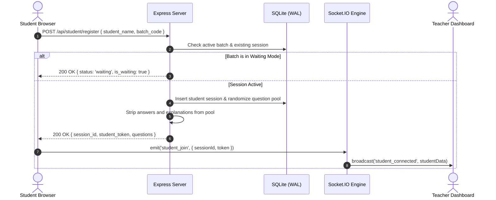

# 🏛️ System Architecture Specification (ARCHITECTURE.md) — ExamShield LAN

**System:** ExamShield LAN  
**Version:** v2.5.16  
**Status:** Approved Enterprise Architecture Specification  
**Author:** Antigravity Senior Software Architect  

---

## 1. Architectural Overview & Design Rationales

ExamShield LAN is architected as an **Air-Gapped, Zero-Cloud Local Area Network Assessment System**. 

```mermaid
flowchart TD
    subgraph LAN_Network["Physical Isolated Local Area Network (Zero Internet)"]
        subgraph Teacher_Station["Teacher / Host Station (Port 3000)"]
            NodeHost["Node.js Host Server & Socket.IO Engine"]
            SQLiteWAL[("SQLite Embedded Database\n(WAL Mode, Zero Deadlock)")]
            TeacherUI["Teacher Control Center\n(Vanilla JS + Tailwind + Sockets)"]
            ExportEng["Export & Analytics Engine\n(ExcelJS / CSV BOM)"]
            DocxParser["Mammoth .docx Ingestion\n& Diagram Extractor"]
            
            NodeHost <--> SQLiteWAL
            TeacherUI <--> NodeHost
            NodeHost --> ExportEng
            NodeHost --> DocxParser
        end

        subgraph Student_Terminals["Student Examination Terminals (100–200+ Clients)"]
            WebClient["Web Browser Client\n(Chrome / Edge / Firefox)"]
            KioskClient["Electron Desktop Kiosk App\n(Fullscreen Lock, Win32 Hooks)"]
        end

        WebClient <-->|REST API + WebSockets\n(Sub-25ms Latency)| NodeHost
        KioskClient <-->|REST API + WebSockets| NodeHost
    end
```

### 1.1 Technology Stack & Decision Matrix

| Layer | Selected Technology | Rationale & Trade-off Justification |
|---|---|---|
| **Runtime Environment** | Node.js (LTS v18 – v24) | High throughput event-driven I/O ideal for 200+ concurrent websocket heartbeats; zero compile dependencies on host. |
| **Backend Framework** | Express.js | Mature, lightweight HTTP routing with minimal attack surface; excellent middleware chaining. |
| **Real-Time Communication** | Socket.IO (v4) | Automatic reconnection, room isolation (`teacher_room`, `student_<id>`), sub-20ms event latency over LAN. |
| **Database Engine** | SQLite (via `better-sqlite3` / `sqlite3` in WAL Mode) | Zero external database server setup required. Write-Ahead Logging allows simultaneous reads and sequential non-blocking writes. |
| **Document Parsing** | Mammoth.js | Extracts raw paragraphs, question stems, and embeds diagram images without requiring Microsoft Word installed on host. |
| **Frontend UI** | HTML5 / Vanilla Modern JS + Tailwind CSS (bundled) | 100% offline; zero node_modules or CDN required on client machines; ultra-fast initial page load (< 200ms). |
| **Desktop Kiosk Client** | Electron | Fullscreen kiosk lock, native Windows taskbar suppression, prevents window switching on student workstations. |
| **Installer / Uninstaller** | C# (.NET Framework 4.0 / 4.8) via `csc.exe` | Zero-dependency native Windows setup executable that extracts payload, sets firewall rules, and creates start-menu shortcuts. |

---

## 2. Directory & Component Architecture

```
ExamShield LAN/
├── ExamShield_LAN_v2.5.16_Setup.exe       # Standalone compiled Windows installer
├── ExamShield_Teacher_Server.bat          # 1-Click launcher batch script
├── ExamShield_Student_Browser.bat         # 1-Click student launcher
├── ExamShield_LAN_Documentation.docx      # Technical user documentation
├── PRD.md                                 # Product Requirements Document
├── DESIGN.md                              # UI/UX & Design Tokens
├── ARCHITECTURE.md                        # This architecture document
├── DATABASE.md                            # Database schema & migrations
├── API.md                                 # HTTP & WebSocket API contracts
├── AGENTS.md                              # AI Agent coding rules & invariants
├── VIBECODING_PLAYBOOK.md                 # 20-Prompt Master Playbook
├── scripts/
│   ├── build-distribution.ps1            # Distribution packaging & C# compiler script
│   ├── Installer.cs                      # Native C# Setup installer source
│   └── Uninstaller.cs                    # Native C# Uninstaller source
├── quality-audit/
│   └── IMPLEMENTATION_LOG.md              # Complete chronological modification audit log
├── sample-papers/                         # Sample Word and JSON question papers
└── teacher-server-app/
    ├── package.json
    ├── unitTests.js                       # 22 Automated unit tests
    ├── securityTests.js                   # 10 Security regression scenarios
    ├── examshield.db                      # SQLite WAL database
    └── src/
        ├── server.js                      # Application entrypoint & HTTP server
        ├── database.js                    # Database connection, schemas, migrations
        ├── examEngine.js                  # Question pool, grading, marking schemes
        ├── analyticsEngine.js             # Performance percentiles & topic stats
        ├── exportEngine.js                # Master Excel (.xlsx) & CSV generation
        ├── historyLogger.js               # Submission permanent history audit file
        ├── middleware/
        │   └── auth.js                    # Token verification, size guards, async handlers
        ├── routes/
        │   ├── studentRoutes.js           # Student onboarding, submission, reviews
        │   └── teacherRoutes.js           # Admin settings, freeze, unfreeze, exports
        ├── sockets/
        │   └── proctoringSocket.js        # Live telemetry, focus loss, alerts
        ├── public/                        # Student Portal Static Files
        │   └── index.html                 # Student client (SPA)
        └── teacher-ui/                    # Teacher Control Center Static Files
            └── index.html                 # Admin console (SPA)
```

---

## 3. Data Flow & Execution Lifecycles

### 3.1 Student Registration & Exam Start


### 3.2 Proctoring Infraction & Lockout Lifecycle
```mermaid
sequenceDiagram
    autonumber
    actor Candidate as Student Browser
    participant Socket as Socket.IO Engine
    participant DB as SQLite
    actor Proctor as Teacher Dashboard

    Note over Candidate: Candidate presses Alt+Tab or switches window
    Candidate->>Candidate: Trigger blur event (after 1500ms grace window)
    Candidate->>Socket: emit('focus_lost', { sessionId, reason })
    Socket->>DB: Increment violations_count & append to violations_json
    Socket->>Proctor: emit('red_alert', { student_name, reason, count })
    Socket->>Candidate: emit('exam_frozen', { reason, violations_count })
    Note over Candidate: Screen locked with red security overlay
    
    Proctor->>Socket: emit('proctor_unfreeze', { sessionId })
    Socket->>DB: Update session state to active
    Socket->>Candidate: emit('exam_unfrozen', { token })
    Note over Candidate: Overlay removed; exam resumes instantly
```

---

## 4. Security Boundaries & Threat Modeling

1. **Air-Gapped Isolation:** Zero external internet dependencies. No CDNs, third-party fonts, analytics trackers, or external APIs.
2. **Cryptographic Token Binding:** Every student receives a 48-character hex token (`crypto.randomBytes(24)`). Every answer save, status update, and submission must present this token in headers (`x-student-token`).
3. **DoS & Request Body Guards:** Student endpoints are strictly limited to `200KB` payloads (`studentBodySizeGuard`), preventing memory exhaustion attacks while allowing 50MB question bank uploads on admin routes.
4. **Answer Key Secrecy:** Correct answers (`answer`) and teacher explanations are scrubbed from question payloads before delivering to candidates.
5. **Fullscreen & Escape Key Handling:** Accidental `Escape` key presses are decoupled from security violation triggers, supported by a 1500ms transient blur suppression window.
6. **XSS Defense:** Candidate names are sanitized on ingestion (stripping HTML tags), and all dynamic values rendered in the DOM are escaped using `escapeHtml()`.

---

## 5. Testing & Deployment Strategy

- **Automated Unit Testing:** 6 suites containing 22 comprehensive tests (`node unitTests.js`), verifying:
  - Standard & Competitive Marking schemes (+4 / -1 / 0 calculations).
  - Negative score percentage clamping at 0%.
  - Database schema migrations and session persistence.
  - Exporter UTF-8 BOM CSV and Excel `.xlsx` generation.
  - History logger formatting.
  - Boundary conditions and zero-division defenses.
- **Automated E2E CDP Testing:** Headless Chrome test runner (`scratch/cdp_full_audit.js`) verifying:
  - Complete student examination lifecycle.
  - Clean console logs (0 exceptions, 0 errors).
  - All 5 teacher console tabs.
- **Production Build:** PowerShell script (`scripts/build-distribution.ps1`) compiling standalone executable and 7-zip portable payloads in under 20 seconds.
