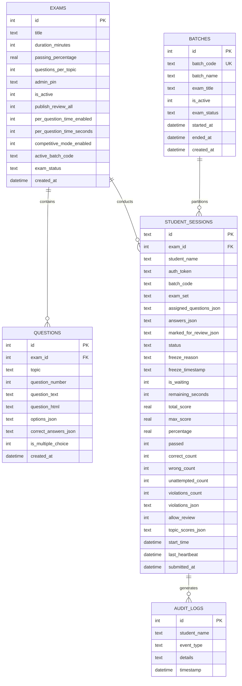

# 🗄️ Database Architecture & Data Model (DATABASE.md) — ExamShield LAN

**System:** ExamShield LAN  
**Version:** v2.5.16  
**Status:** Approved Production Schema  
**Author:** Antigravity Senior Database Architect & Backend Engineer  

---

## 1. Database Technology & Pragmas

ExamShield LAN leverages an embedded **SQLite 3** engine configured for high-concurrency, low-latency, zero-configuration local area network operation.

```sql
PRAGMA journal_mode = WAL;          -- Write-Ahead Logging for non-blocking concurrent reads and writes
PRAGMA busy_timeout = 5000;         -- 5-second automatic retry on lock contention (zero deadlocks)
PRAGMA synchronous = NORMAL;        -- Balanced high write throughput with power-loss crash durability
```

---

## 2. Entity-Relationship (ER) Diagram



---

## 3. Detailed Table DDL & Schema Definitions

### 3.1 Table: `exams`
Stores examination configurations, pass thresholds, pacing models, and administrative controls.

| Column | Type | Constraints | Default | Description |
|---|---|---|---|---|
| `id` | `INTEGER` | `PRIMARY KEY AUTOINCREMENT` | - | Unique exam identifier |
| `title` | `TEXT` | `NOT NULL` | - | Name of examination |
| `duration_minutes` | `INTEGER` | `NOT NULL` | `60` | Full exam countdown time in minutes |
| `passing_percentage` | `REAL` | `NOT NULL` | `70` | Passing grade threshold percentage |
| `questions_per_topic` | `INTEGER` | `NOT NULL` | `15` | Random question pool sample limit per topic |
| `admin_pin` | `TEXT` | `NOT NULL` | `'admin123'` | Proctor console authorization PIN |
| `is_active` | `INTEGER` | `NOT NULL` | `1` | 1 if active, 0 if archived |
| `publish_review_all` | `INTEGER` | `NOT NULL` | `0` | 1 unlocks solutions for all students globally |
| `per_question_time_enabled` | `INTEGER` | `NOT NULL` | `0` | 1 enforces per-question countdown lock |
| `per_question_time_seconds` | `INTEGER` | `NOT NULL` | `60` | Per-question countdown duration |
| `competitive_mode_enabled` | `INTEGER` | `NOT NULL` | `0` | 1 enforces +4 / -1 negative marking |
| `active_batch_code` | `TEXT` | `NOT NULL` | `'BATCH-01'` | Currently selected batch shift |
| `exam_status` | `TEXT` | `NOT NULL` | `'not_started'` | `not_started`, `active`, or `ended` |
| `created_at` | `DATETIME` | - | `CURRENT_TIMESTAMP` | Exam record creation timestamp |

---

### 3.2 Table: `batches`
Partitions candidate cohorts across classroom shifts and examination sessions.

| Column | Type | Constraints | Default | Description |
|---|---|---|---|---|
| `id` | `INTEGER` | `PRIMARY KEY AUTOINCREMENT` | - | Unique batch row ID |
| `batch_code` | `TEXT` | `NOT NULL UNIQUE` | - | Short alphanumeric code (e.g., `BATCH-01`) |
| `batch_name` | `TEXT` | `NOT NULL` | - | Friendly title (e.g., `Morning Shift 1`) |
| `exam_title` | `TEXT` | - | `NULL` | Assigned examination title |
| `is_active` | `INTEGER` | `NOT NULL` | `0` | 1 if active, 0 otherwise |
| `exam_status` | `TEXT` | `NOT NULL` | `'not_started'` | `not_started` (Waiting Room), `active`, `ended` |
| `started_at` | `DATETIME` | - | `NULL` | Timestamp when proctor clicked Start |
| `ended_at` | `DATETIME` | - | `NULL` | Timestamp when proctor clicked Stop |
| `created_at` | `DATETIME` | - | `CURRENT_TIMESTAMP` | Batch registration timestamp |

---

### 3.3 Table: `questions`
Stores individual questions, options, diagram HTML, topics, and answer keys.

| Column | Type | Constraints | Default | Description |
|---|---|---|---|---|
| `id` | `INTEGER` | `PRIMARY KEY AUTOINCREMENT` | - | Question ID |
| `exam_id` | `INTEGER` | `NOT NULL, FK(exams.id)` | - | Parent exam reference |
| `topic` | `TEXT` | `NOT NULL` | - | Topic or section header (e.g., Networking) |
| `question_number` | `INTEGER` | - | `NULL` | Original number in uploaded paper |
| `question_text` | `TEXT` | `NOT NULL` | - | Plain text question stem |
| `question_html` | `TEXT` | `NOT NULL` | - | HTML question stem with embedded diagram images |
| `options_json` | `TEXT` | `NOT NULL` | - | JSON Array of options: `[{"label": "A", "text": "..."}]` |
| `correct_answers_json` | `TEXT` | `NOT NULL` | - | JSON Array of correct letters: `["A", "C"]` |
| `is_multiple_choice` | `INTEGER` | `NOT NULL` | `0` | 1 if multi-select, 0 if single choice |
| `created_at` | `DATETIME` | - | `CURRENT_TIMESTAMP` | Ingestion timestamp |

---

### 3.4 Table: `student_sessions`
Core transaction table tracking candidate exam state, answers, timers, security violations, and final grades.

| Column | Type | Constraints | Default | Description |
|---|---|---|---|---|
| `id` | `TEXT` | `PRIMARY KEY` | - | Unique session ID (e.g., `s_1794137827525_xb71h8`) |
| `exam_id` | `INTEGER` | `NOT NULL, FK(exams.id)` | - | Parent exam reference |
| `student_name` | `TEXT` | `NOT NULL` | - | Sanitized candidate full name |
| `auth_token` | `TEXT` | - | `NULL` | Cryptographic session bearer token (48-char hex) |
| `batch_code` | `TEXT` | `NOT NULL` | `'BATCH-01'` | Assigned examination batch code |
| `exam_set` | `TEXT` | `NOT NULL` | `'Random'` | Set indicator (`Randomized`) |
| `assigned_questions_json` | `TEXT` | `NOT NULL` | - | Ordered JSON array of assigned question objects |
| `answers_json` | `TEXT` | `NOT NULL` | `'{}'` | JSON Map of candidate responses: `{"1": ["A"]}` |
| `marked_for_review_json` | `TEXT` | `NOT NULL` | `'[]'` | JSON Array of question IDs marked for review |
| `status` | `TEXT` | `NOT NULL` | `'in_progress'` | `in_progress`, `waiting`, `frozen`, or `submitted` |
| `freeze_reason` | `TEXT` | - | `NULL` | Security infraction reason if locked |
| `freeze_timestamp` | `TEXT` | - | `NULL` | ISO timestamp when terminal was frozen |
| `is_waiting` | `INTEGER` | `NOT NULL` | `0` | 1 if waiting in lounge before start |
| `remaining_seconds` | `INTEGER` | `NOT NULL` | - | Seconds remaining on global exam timer |
| `total_score` | `REAL` | `NOT NULL` | `0` | Final score achieved (supports negative values) |
| `max_score` | `REAL` | `NOT NULL` | `0` | Maximum possible marks achievable |
| `percentage` | `REAL` | `NOT NULL` | `0` | Final percentage (clamped at minimum 0.0%) |
| `passed` | `INTEGER` | `NOT NULL` | `0` | 1 if percentage >= passing_percentage, else 0 |
| `correct_count` | `INTEGER` | `NOT NULL` | `0` | Total right questions answered |
| `wrong_count` | `INTEGER` | `NOT NULL` | `0` | Total wrong questions answered |
| `unattempted_count` | `INTEGER` | `NOT NULL` | `0` | Total questions skipped |
| `violations_count` | `INTEGER` | `NOT NULL` | `0` | Total proctoring infractions recorded |
| `violations_json` | `TEXT` | `NOT NULL` | `'[]'` | JSON Array: `[{"index": 1, "reason": "...", "timestamp": "..."}]` |
| `allow_review` | `INTEGER` | `NOT NULL` | `0` | Per-candidate solution unlock flag |
| `topic_scores_json` | `TEXT` | `NOT NULL` | `'{}'` | JSON Breakdown: `{"Networking": {"score": 2, "total": 8}}` |
| `start_time` | `DATETIME` | - | `CURRENT_TIMESTAMP` | ISO 8601 exam start timestamp |
| `last_heartbeat` | `DATETIME` | - | `CURRENT_TIMESTAMP` | Last active ping timestamp |
| `submitted_at` | `DATETIME` | - | `NULL` | ISO 8601 final submission timestamp |

---

## 4. Query Indexes & Performance Tuning

```sql
-- Fast question lookup per topic for random sampling
CREATE INDEX IF NOT EXISTS idx_questions_exam_topic 
ON questions(exam_id, topic);

-- Fast session reconnection lookup by name and batch
CREATE INDEX IF NOT EXISTS idx_sessions_exam_name 
ON student_sessions(exam_id, student_name);

-- Fast batch lookups
CREATE INDEX IF NOT EXISTS idx_sessions_batch 
ON student_sessions(batch_code);
```

---

## 5. Schema Migration & Auto-Evolution Strategy

ExamShield LAN utilizes a defensive auto-migration pattern (`safeAddColumn()`) executed during server initialization. This allows newer versions (e.g., adding `violations_count` or `competitive_mode_enabled`) to run on existing legacy database files without corrupting previous exam records.

```javascript
const safeAddColumn = (table, colDef) => {
  try {
    db.prepare(`ALTER TABLE ${table} ADD COLUMN ${colDef}`).run();
  } catch (err) {
    // Column already exists - no op
  }
};
```

---

## 6. Backup & Disaster Recovery

- **Single-File Portability:** The entire database resides in `examshield.db`.
- **Live Backup Safe:** Because SQLite runs in WAL mode, copying `examshield.db` while the server is running produces a consistent snapshot.
- **Auto-History Persistence:** When an exam is ended or submitted, results are synchronously appended to both the database and plain-text append-only files (`history.txt` and `history.csv`) ensuring total redundancy against catastrophic power failure.
